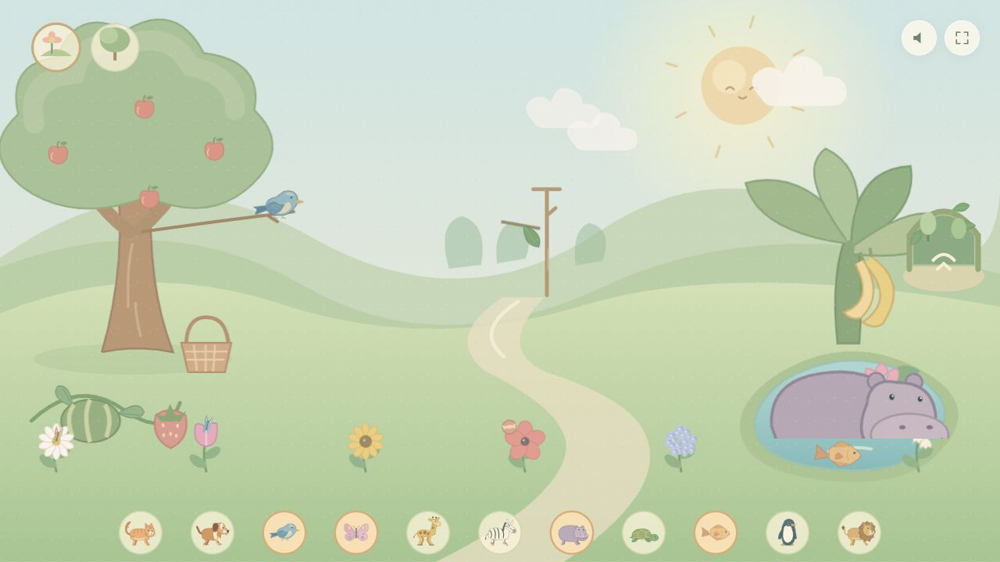

# Spring Garden — an animal game for toddlers around age 2

[中文](README.md) · **English**

I first made this little garden for a **child around age 2 who loves animals**: a place to tap, listen, and explore together. It is now free and open source for other parents looking for a simple animal game to enjoy with their children.

There are no scores, levels, or reading tasks. Tap an animal and watch it respond, pick apples, watch a dog fetch its ball, or let an elephant spray water. Wander through the garden by day or night, at your own pace.

**[🌿 Play online](https://marquis-chan.github.io/spring-garden/)** · **[⬇ Download the offline game (one HTML file, about 2.7 MB)](https://github.com/Marquis-Chan/spring-garden/releases/latest/download/spring-garden.html)** · [All releases](https://github.com/Marquis-Chan/spring-garden/releases) · [Feedback and ideas](https://github.com/Marquis-Chan/spring-garden/issues)



## Download and play

1. Download `spring-garden.html` using the link above.
2. Double-click it on a computer and open it in Chrome, Edge, or another modern browser.
3. The first tap enables sound. Explore together with your child.

**No installation, no account, and no ads. It works offline after downloading.** The code, illustrations, and audio are included in one file. Opening local HTML on phones and tablets varies by system and browser; a desktop browser is the recommended starting point.

## Inside the garden

- Three illustrated habitats: a meadow, an Asian woodland, and an American canopy, with 23 kinds of animal characters.
- Tap animals to interact, use animal icons to invite visitors, and use the leafy gates to change habitats.
- Pick and collect apples, play fetch, watch an elephant spray water and bees forage, and discover animals eating or resting.
- Switch between day and night, drag the clouds, and hear 17 real animal and nature recordings. Some animals remain quiet.
- Sound and fullscreen controls are at the top right. On a computer, **Ctrl + Shift + P** opens parent settings for volume and session length.

This is a small project that is still being improved. Feedback from families is welcome. It is made for shared play and exploration, without claims of specific educational outcomes.

## Make it your own

Fork the project, open an Issue, or send a Pull Request. Improve touch support, refine animal movements, add habitats, or make a version for your own family. Please include the source and license of any new recordings or images.

For the source archive, select **Code → Download ZIP** on GitHub. After extracting it, open `春日小花园.html` to play. To rebuild after changing the source, install Node.js and run:

```sh
node tools/build.mjs
node --test tests/*.test.cjs
node tests/release-audit.cjs
```

JavaScript is in `src/`, illustrations and layout are in `index.template.html` and the CSS files, and audio and attribution are in `assets/`. See [development notes](DEVELOPMENT.md) for detailed gameplay and implementation records (Chinese).

Pushes to `main` rebuild, verify, and deploy the online game through GitHub Actions. Offline download packages are published through Releases.

## License and credits

Original code, SVG illustrations, and documentation use the [MIT License](LICENSE). You may use, change, and share them while preserving the license notice. **Third-party recordings retain their individual licenses**, including CC0, CC BY, CC BY-SA, and public-domain declarations. See [recording attribution and licenses](THIRD_PARTY_NOTICES.md) before reusing or modifying audio. License and recording credits are also included in the standalone game file.

Thank you to the authors who shared their animal and nature recordings. I hope this little garden brings a little joy to more children who love animals.

Keywords: toddler game, animal game for kids, parent-child play, offline HTML5 game, interactive storybook, free and open source.
